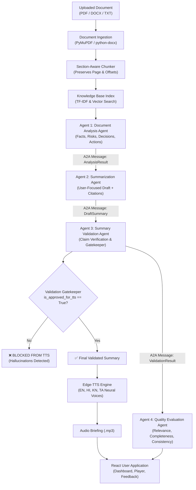

# AI Powered Document Summarization & Voice Generation Assistant

[](https://fastapi.tiangolo.com)
[](https://react.dev)
[](https://github.com/rany2/edge-tts)
[](https://pytest.org)

An enterprise-grade document intelligence system designed for long, structured documents (policy briefs, congressional reports, audit reports, technical documentation). The platform features an end-to-end multi-agent pipeline with structural preservation, strict source grounding, claim-level factual validation, academic quality evaluation, and multilingual neural text-to-speech synthesis exclusively on certified summaries.

---

## 1. Project Overview & Problem Statement
Large organizational documents frequently exceed hundreds of pages. Traditional summarization approaches suffer from three fatal flaws:
1. **Context Loss & Structure Flattening**: Naive chunking breaks tables, ignores page numbers, and loses section hierarchies.
2. **Hallucination & Factual Drift**: LLMs invent statistics, dates, and names not present in the source text.
3. **Premature Voice Synthesis**: Synthesizing audio directly from unverified draft summaries spreads misinformation in executive audio briefings.

**Our Solution**:
This system introduces an **Agentic Handoff Pipeline** that extracts structured intelligence, drafts user-focused summaries with explicit chunk citations, subjects drafts to an uncompromising **Summary Validation Agent (Gatekeeper)**, scores output along six evaluation dimensions, and converts **ONLY** certified, validated summaries into neural audio briefings.

---

## 2. Key Features

- **Multi-Format Ingestion**:
  - High-performance extraction of **PDF** (PyMuPDF), **DOCX** (python-docx), and **TXT**.
  - Preserves page numbers, headers, and section hierarchies.
  - Safe file handling with magic-byte verification and 25MB boundary defense.
- **Section-Aware Chunking & Local Knowledge Base**:
  - Sliding window chunking with metadata tagging (`document_id`, `page_number`, `section_title`, `chunk_id`, offsets).
  - Built-in local TF-IDF and cosine vector index for fast source retrieval and citation verification.
- **Multi-Agent Document Intelligence**:
  - **Agent 1: Document Analysis Agent**: Extracts Key Facts, Risks (with severity rankings), Decisions, Policy Recommendations, and Action Items.
  - **Agent 2: Summarization Agent**: Formulates context-aware summaries tailored to user focus ("Risks and Decisions", "Executive Summary", "Action Plan").
  - **Agent 3: Summary Validation Agent (Gatekeeper)**: Evaluates draft claims against source chunks, scrubs hallucinations, and certifies summaries for TTS.
  - **Agent 4: Quality & Evaluation Agent**: Evaluates summaries across Relevance, Completeness, Factual Consistency, Groundedness, Quality, and Validation Accuracy.
- **Strict TTS Gatekeeper Enforcement**:
  - Enforces hard safety barriers: Draft or unverified summaries are cryptographically and logically prohibited from audio conversion.
- **Multilingual Neural Text-to-Speech (Edge-TTS)**:
  - Generates natural, human-sounding audio briefings in **English**, **Hindi**, **Kannada**, and **Tamil**.
  - Built-in HTML5 audio player and MP3 download options.
- **GovReport Academic Benchmark**:
  - Integrated with the **GovReport Long Document Summarization Dataset** (GAO and CRS federal reports).
  - Computes standard metrics (Relevance, Completeness, Consistency, Groundedness).
- **User Feedback Loop**:
  - Allows users to rate summaries (1-5 stars), certify factual accuracy, and record qualitative feedback into SQLite.

---

## 3. System Architecture & Agent Workflow

### Visual Architecture Diagram
The architecture diagram is available in high resolution in `docs/`:
- **PNG**: `docs/architecture_diagram.png`
- **PDF**: `docs/architecture_diagram.pdf`
- **JPEG**: `docs/architecture_diagram.jpg`



### Agent-to-Agent (A2A) Communication Protocol
Communication between agents is governed by strict, strongly-typed Pydantic contracts:
- `A2AMessageEnvelope`: Transports headers (`sender`, `recipient`, `timestamp`, `workflow_run_id`, `document_id`).
- `DocumentAnalysisResult`: Structured array of `FactItem`, `RiskItem`, `DecisionItem`, `RecommendationItem`, and `ActionItem`.
- `DraftSummaryResult`: Contains `executive_summary`, `key_findings`, and explicit `source_references` (`page`, `section`, `chunk_id`).
- `ValidationResult`: Contains `factual_consistency_score`, `groundedness_score`, `unsupported_claims`, `final_validated_summary`, and `is_approved_for_tts`.
- `QualityMetrics`: Multi-dimensional evaluation scores and qualitative explanations.

---

## 4. Technology Stack
- **Backend**: Python 3.10+, FastAPI, Uvicorn, SQLAlchemy, SQLite, Pydantic v2.
- **Frontend**: React, Vite, TypeScript, Tailwind CSS, Lucide Icons, HTML5 Audio.
- **Document Processing**: PyMuPDF (`fitz`), `python-docx`.
- **AI / LLM**: Google Gemini API (`gemini-1.5-flash` / `gemini-2.0-flash`) with intelligent deterministic offline fallback.
- **Voice Generation**: Microsoft Edge-TTS (`edge-tts`).
- **Knowledge Base**: Local TF-IDF & Vector Index.
- **Evaluation & Benchmarking**: GovReport Long-Doc Benchmark Evaluator.
- **Testing**: Pytest, Pytest-Asyncio, HTTPX.

---

## 5. Installation & Setup

### Prerequisites
- Python 3.10 or 3.11+
- Git

### 1. Clone the Repository
```bash
git clone https://github.com/your-org/document-summarization.git
cd document-summarization
```

### 2. Create Virtual Environment
```bash
python -m venv venv
# Windows:
.\venv\Scripts\activate
# Linux/macOS:
source venv/bin/activate
```

### 3. Install Dependencies
```bash
pip install -r requirements.txt
```

### 4. Configure Environment Variables
Copy `.env.example` to `.env`:
```bash
cp .env.example .env
```
Edit `.env`:
```ini
# Gemini API Key (Optional: system works in smart offline mode if omitted)
GEMINI_API_KEY=your_gemini_api_key_here
GEMINI_MODEL=gemini-1.5-flash

# Backend & Frontend
BACKEND_HOST=127.0.0.1
BACKEND_PORT=8000
FRONTEND_PORT=5173
BACKEND_API_URL=http://127.0.0.1:8000
```

---

## 6. How to Run the Application

### Option A: Launch Both Services Concurrently (Recommended)
```bash
python run.py
```
This automatically initializes the SQLite database, launches the FastAPI backend on `http://127.0.0.1:8000`, waits for the health check, and opens the React + Vite frontend at `http://localhost:5173`.

### Option B: Run Services Individually
**Terminal 1 (Backend API):**
```bash
python -m uvicorn backend.main:app --host 127.0.0.1 --port 8000 --reload
```
Interactive API Documentation (Swagger UI): `http://127.0.0.1:8000/docs`

**Terminal 2 (React UI):**
```bash
cd frontend
npm run dev
```

### Option C: Generate Architecture Diagrams
```bash
python run.py diagram
```
Outputs high-resolution diagrams to `docs/architecture_diagram.png`, `.pdf`, and `.jpg`.

---

## 7. Sample Usage Walkthrough

1. **Upload Document**: Navigate to **🏠 Dashboard & Ingestion**, upload a PDF (e.g. federal report, research paper, contract).
2. **Review Structure**: Inspect detected sections and indexed chunks with token estimates and page numbers.
3. **Execute Agent Workflow**:
   - Go to **🤖 Multi-Agent Workflow**.
   - Select your requested focus (e.g., *"Identify the major risks and decisions"* or *"Comprehensive Executive Briefing"*).
   - Select target language (English, Hindi, Kannada, Tamil).
   - Click **Run Multi-Agent Intelligence Pipeline**.
4. **Inspect Validated Summary**:
   - Go to **📑 Summary & Findings** to view the certified executive summary and key findings with source citations.
5. **Inspect Intelligence**:
   - Go to **🔍 Extracted Intelligence** to examine categorized risks with severity badges, decisions, and action items.
6. **Review Validation Gatekeeper**:
   - Check **🛡️ Validation Gatekeeper** to see scrubbed claims, factual consistency scores, and TTS safety approval status.
7. **Listen to Audio**:
   - Go to **🎙️ Audio Briefing**, select a neural voice, and click **Generate Audio Briefing**.
   - Play the audio in-browser or download the `.mp3`.
8. **Academic Evaluation**:
   - Go to **📚 GovReport Benchmark** to evaluate performance against standard federal reports (GAO-21-104 or CRS-R46240).
9. **Submit Feedback**:
   - Go to **⭐ User Feedback** to submit ratings and comments.

---

## 8. GovReport Benchmark & Evaluation Guide

### 8.1 Why GovReport is Used
The [GovReport Summarization Dataset](https://huggingface.co/datasets/ccdv/govreport-summarization) (`ccdv/govreport-summarization`) contains official, long-form U.S. government policy and audit reports published by the **Government Accountability Office (GAO)** and the **Congressional Research Service (CRS)**, paired with expert human-authored executive summaries.
GovReport serves as an academic benchmark because:
1. **Realistic Document Length**: Average reports exceed 9,000 words across multi-tiered structural sections.
2. **Dense Domain Knowledge**: Demands accurate preservation of budgets, dates, statutory mandates, and policy findings.
3. **Rigorous Ground-Truth**: Expert summaries provide ground-truth reference text for evaluating factual accuracy, ROUGE overlap, and thematic completeness.

### 8.2 How to Obtain & Use the Dataset
- The project integrates directly with Hugging Face Hub using streaming mode (`streaming=True`), enabling instant evaluation of arbitrary subset sizes without downloading the full multi-gigabyte dataset.
- Local sample documents from GAO and CRS are also preloaded into `data/govreport_samples/` to support offline evaluation.

### 8.3 Running a Benchmark
Run a small benchmark of 3 to 5 documents to verify the summarization pipeline quickly:
```bash
# Direct runner (recommended)
python evaluation/evaluate_govreport.py --limit 3

# Or via project launcher
python run.py benchmark --limit 3
```

### 8.4 Scaling Up the Benchmark
To evaluate larger sample sizes across different dataset splits:
```bash
# Evaluate 10 documents from test split
python evaluation/evaluate_govreport.py --limit 10 --split test

# Evaluate 25 documents with custom focus
python evaluation/evaluate_govreport.py --limit 25 --split test --focus "Risks and Operational Recommendations"

# Run in quiet mode (table summary only)
python evaluation/evaluate_govreport.py --limit 20 -q
```

### 8.5 Evaluation Metrics Explained

| Metric | Dimension | Meaning & Interpretation |
| :--- | :--- | :--- |
| **Overall Quality** | Composite Index | Weighted composite across all quality, groundedness, and consistency dimensions (0–100%). |
| **Factual Consistency** | Factual Fidelity | Percentage of claims and numbers that do not contradict or fabricate facts beyond source document chunks. |
| **Source Groundedness** | Citation Traceability | Presence and precision of verifiable metrics, currency values, dates, and section/page references. |
| **Relevance** | Semantic Alignment | Alignment of topics and key takeaways with the human-authored reference summary. |
| **Completeness** | Structural Coverage | Coverage of foundational scope, findings, risk factors, governance decisions, and action roadmaps. |
| **Validation Accuracy** | Gatekeeper Rigor | Percentage of individual assertions certified by the Summary Validation Agent. |
| **ROUGE-1 (F1)** | Lexical Overlap | Harmonic mean of unigram precision and recall against the reference summary. |
| **ROUGE-2 (F1)** | Contextual Overlap | Bigram phrase overlap evaluating local phrasing and technical terminology fidelity. |
| **ROUGE-L (F1)** | Sequence Match | Longest Common Subsequence (LCS) overlap reflecting sentence-level flow. |
| **TTS Gatekeeper Rate**| Safety Compliance | Percentage of summaries that met factual thresholds and were approved for audio briefing generation. |

### 8.6 Benchmark Results Storage
Benchmark outputs are automatically persisted to `data/benchmark_results/`:
- **JSON Reports**: `data/benchmark_results/govreport_benchmark_<timestamp>.json` and `govreport_benchmark_latest.json`
- **Markdown Reports**: `data/benchmark_results/govreport_benchmark_<timestamp>.md` and `govreport_benchmark_latest.md`

---

## 9. Automated Testing
Run the comprehensive Pytest test suite:
```bash
pytest -v
```
Or via the launcher:
```bash
python run.py test
```

### Test Coverage Includes:
- `test_extraction.py`: PDF, DOCX, TXT parsing, section and page preservation.
- `test_chunking.py`: Section-aware sliding window chunking and offset tracking.
- `test_vector_index.py`: TF-IDF cosine similarity search and keyword retrieval.
- `test_agents.py`: Individual verification of all 4 specialized agents.
- `test_agent_handoff.py`: End-to-end pipeline execution and A2A contracts.
- `test_validation_logic.py`: Hallucination detection, numerical verification, and claim scrubbing.
- `test_tts.py`: Strict blocking of unapproved or draft summaries from TTS.
- `test_api_endpoints.py`: Integration tests for all FastAPI REST endpoints.

---

## 10. Security & Safety Design
- **Zero Hardcoded Secrets**: All API keys and endpoints are configured strictly via `.env`.
- **Validation Barrier**: Draft summaries are prevented from reaching TTS via programmatic exceptions and HTTP 403 blocks.
- **Upload Hardening**: File extensions, sizes, and file headers (`%PDF`, `PK\x03\x04`) are validated before disk persistence.
- **Directory Traversal Defense**: All filenames are sanitized with UUIDs and validated against parent directories.

---

## 11. Troubleshooting

| Issue | Cause | Solution |
| :--- | :--- | :--- |
| `Backend Unreachable` in React UI | FastAPI backend is not running | Run `python -m uvicorn backend.main:app --port 8000` or launch via `python run.py`. |
| `Gemini API quota exceeded` | Rate limit on free tier | The system automatically falls back to the smart offline deterministic processor without crashing. |
| `Edge-TTS Network Error` | Internet connection blocked | Ensure port 443 outbound is accessible for Microsoft Edge TTS endpoints. |
| `Corrupt PDF Error` | Non-standard or password-protected PDF | Ensure the PDF is not encrypted and contains standard text layers. |

---

## 12. Future Enhancements
- OCR integration via Tesseract or Google Cloud Vision for scanned raster PDFs.
- Hierarchical Map-Reduce summarization for 500+ page book-length documents.
- Real-time WebRTC audio streaming for live voice briefing synthesis.
